# Metavido viewer: notes from the exploration branch

A page that plays a workshop recording (Keijiro Takahashi's Metavido format, filmed
on iPhone) as **live 3D in the browser**. Every video frame is decoded on the GPU
and reconstructed while it plays, so you can orbit, pan and zoom freely. It is not
a pre-rendered video. Black background. Built on the branch `metavido-viewer`,
following the feasibility study in `METAVIDO.md`.

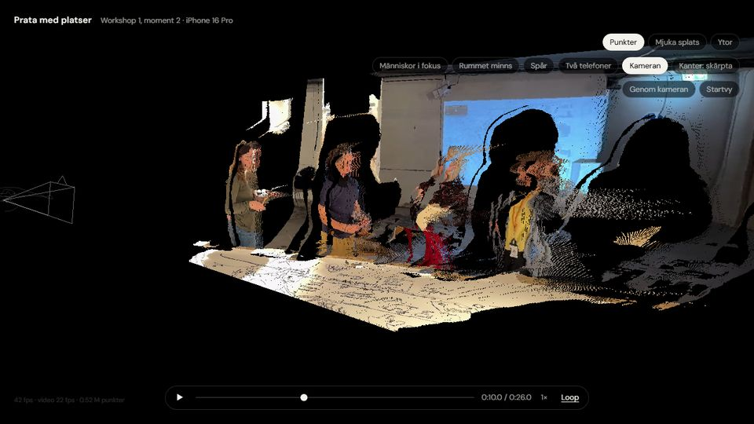

## Running it

```sh
cd web-src
npm install
npx vite                     # dev:  http://localhost:5173/video/
npx vite build               # writes ../web, as for the rest of the site
npx vite preview             # prod: http://localhost:4173/video/
```

Use `vite preview` (or any server with HTTP byte ranges) to look at the built
site. `python3 -m http.server` can't serve ranges, so the video can't seek there.
GitHub Pages can.

In the page: drag to orbit, right-drag or two fingers to pan, scroll or pinch to
zoom. Space plays and pauses, the arrow keys step a frame (Shift: 10 frames),
F looks through the phone that filmed, C toggles the phone gizmo, R resets the view.
Every setting is also in the URL, so a view can be linked:

| Parameter | |
|---|---|
| `look=punkter\|mjuk\|ytor` | points (default), soft splats, oriented surfels |
| `people=1` `memory=1` `trails=1` `duo=1` | the creative layers (below) |
| `edges=snap\|drop\|keep` | depth-edge handling (default snap) |
| `follow=1` | view through the recording phone |
| `res=2` | half resolution (the default on phones) |
| `t=12.5` `paused=1` | start time, start paused |
| `debug` | frame-sync check, GPU time per frame, renderer name |
| `why` | colour edge samples: snapped magenta, people green |
| `tint` | with `duo=1`: 16 Pro orange, 12 Pro blue, to judge the alignment |

The page is not linked from the menu and is `noindex`, like `/map/`.

## The clips

All recordings in `Workshop1/` are real Metavido: 1920×1080 with the four-quadrant
layout, and the barcode decodes in every frame. All were filmed in **landscape**
(people stand upright in the colour half). So the portrait problem from
`METAVIDO.md` (90° roll, wrong fov) **does not apply**, and the encoded fov is used
as is: 44.0° vertical / 71.4° horizontal on the 16 Pro, 41.0° / 67.2° on the 12 Pro.

| File | Source | Range | Size |
|---|---|---|---|
| `web/assets/video/moment2-16pro.mp4` + `.json` | `16pro/Workshop1-Moment2-16pro-b.MOV` | 598.000–624.000 s (26 s, the middle of the 1270 s take) | 9.18 MB + 94 kB |
| `web/assets/video/moment2-12pro.mp4` + `.json` | `12pro/Workshop1-Moment2-12pro.MOV` | 939.217–965.217 s (the same 26 s) | 4.74 MB + 93 kB |
| `web/assets/video/moment2-duo.json` | the marker transform between them | | 1 kB |

The 16 Pro snippet is 2026-10-05 15:05:01–15:05:27 UTC. Four people talk across
the table with a takeaway box, gesturing, while the handheld phone drifts about
2.3 m. I picked it from contact sheets of both phones' takes: it shows people
close up and full-length with some movement, and both phones were running.

Encoding is as METAVIDO.md recommends: `-crf 26 -preset slow -r 30 -pix_fmt yuv420p
-movflags +faststart -an`, never rescaled. There is one addition: the output is
**tagged BT.709, limited range**. The recorder's H.264 is untagged, and I checked
what it really is. The depth quadrant's hue colours are written fully saturated,
and decoding with BT.709 limited range gives max/min channel 1.002/−0.001
(sd 0.006). BT.601, which ffmpeg assumes for untagged HD (and which
`Workshop1/tools/align.py` therefore uses), gives 1.03/−0.004 with sd 0.08, an
error that goes straight into the decoded depth. In Chrome the uploaded texture
matches the BT.709 decode to 1/255 on average, with a median depth difference of
5 mm.

Tooling (all in `scripts/`, Python with numpy, plus scipy for fusion):

- `metavido_clip.py SRC START DURATION NAME`: cuts and encodes the snippet,
  writes the pose sidecar, and verifies it.
- `metavido_check.py web/assets/video/NAME.mp4`: metric check (floor, table,
  people's heights) and orthographic views.
- `metavido_sync.py A B --guess S --at T`: time offset between two takes, from audio.
- `metavido_fuse.py OUT.json A.mp4::A.sidecar.jsonl B.mp4::B.sidecar.jsonl`:
  the marker transform, with its residual on the room.

### The barcode is read from the source, not from the web file

Re-encoding flips barcode bits now and then. At CRF 26 it flipped 4 bits in 4 of
780 frames, one of them an exponent bit of `near`, which made that frame invalid.
The source has a couple of its own (one frame each had `near` = 0.23125 and
`far` = 10.00003, single-bit errors). So `metavido_clip.py`:

1. decodes the barcode of every frame of the **source** range,
2. matches each encoded frame to its source frame by Hamming distance over the
   whole barcode, in order (robust even to a flipped hash bit), and
3. writes the sidecar from the source values. Depth range is a recorder constant,
   so frames that disagree with the clip's own mode are pinned to it, and the
   script says so.

It fails loudly if any frame doesn't match, if a source frame is invalid, or if
the pose track jumps more than 10 cm or 10° in a frame. For the 16 Pro clip the
camera moves a median 1.6 mm (max 16 mm) and 0.21° (max 1.25°) per frame.

This backs the study's central recommendation: decoding the barcode in the
browser from the compressed file would occasionally hand the shader a garbage
frame.

## How it works

`web-src/video/metavido.js` is keijiro's `Common.hlsl` + `Utils.hlsl`, ported to
GLSL. The whole frame is one `VideoTexture`, uploaded with `flipY` and
`NoColorSpace` (no colour conversion that could bend the hue). With `flipY`, texel
row 0 is the bottom of the frame, the same v-up convention as Unity, so the
quadrant maths reads like the HLSL. Unity is left-handed, so the sidecar stores
poses already converted: `p = (x, y, −z)`, `q = (−x, −y, z, w)`, camera looking
down −Z.

Each video frame's pose comes from the sidecar by frame number:
`requestVideoFrameCallback` gives `mediaTime`, and the snippets are 30 fps CFR
from 0. With `?debug` a probe reads the barcode's hash lane back from the GPU
texture and compares it with the sidecar's hash for the frame the viewer thinks
it is showing. Over a 24 s playback: **152 of 154 checks exact**. One mismatch was
a bit flipped by the encode; the other was frame 0 at start-up.

### Is it right?

`scripts/metavido_check.py` decodes frames the way the browser does and measures
them:

- **Floor level.** Every horizontal plane found has a tilt of 0.0–0.8° (ARKit's
  world is gravity-aligned and the decode keeps it so).
- **Scale.** The floor is at y = −1.657 m and the table top at −0.93 m (0.73 m
  high). Standing people measure **1.52–1.66 m** from the floor in every checked
  frame. The handheld camera is 1.49 m up.
- **Not mirrored or rotated.** People are upright, and in a top view the
  pillar on the phone's left is on the reconstruction's left.
- **Through the phone** (`follow=1`) the reconstruction lines up with the video.

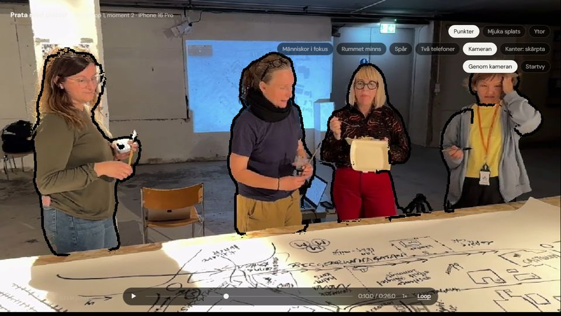

### Depth edges, the hard part

ARKit's depth is smooth across object boundaries. Around a person at 2 m in front
of a wall at 6.5 m it ramps over 20–26 depth pixels and bleeds 30–40 px out past
the human stencil's silhouette. About 14 % of the pixels in the test frame sit on
such ramps. Reconstructed naively they are a **rubber sheet** from every person to
the wall (`edges=keep`):

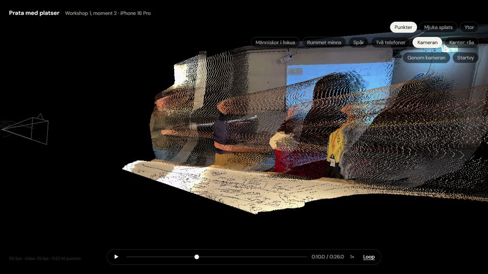

Dropping them (`edges=drop`) leaves a halo as wide as the ramp:

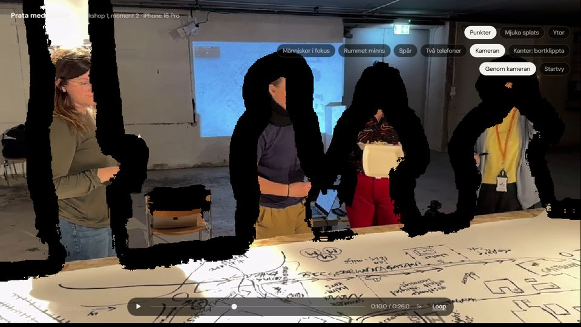

`edges=snap` (the default) moves each ramp sample onto one side instead. A sample
is on a ramp when it is steeper than about 83° to the view ray (judged on its
smoother side), or when **inverse depth bends** over ±12 px: any plane has inverse
depth linear in image space, but a ramp's shoulders don't. The human stencil,
much sharper than the depth, decides which side. Person samples go to the nearest
person depth around them. Background samples next to a person go to the far
plateau if behind them (wall) or the near one if in front (table). Edges with no
person involved split at the ramp's middle. Background samples within 5 px of a
silhouette that end up on the wall still carry the person's colour, so they are
dropped. That leaves the thin dark contour you see in the view through the phone,
and spares the walls a dark outline of everyone.

## The looks and layers

**Punkter** (stage 1, the default). 960×540 = 518k points per frame, each sized
to its depth pixel's footprint, so the cloud is gap-free from the recording
viewpoint. Sprites under 3 px are square, since round ones that small only leave
holes.

**Mjuka splats.** 480×270 gaussian sprites drawn with surface splatting: a depth
pre-pass (pushed back 2 % of depth), weighted accumulation in a half-float target,
then normalisation. Splats within the bias of the front surface blend into one
continuous surface, and those further back fail the depth test. There is no
sorting, so a million splats cost the same per splat as ten.

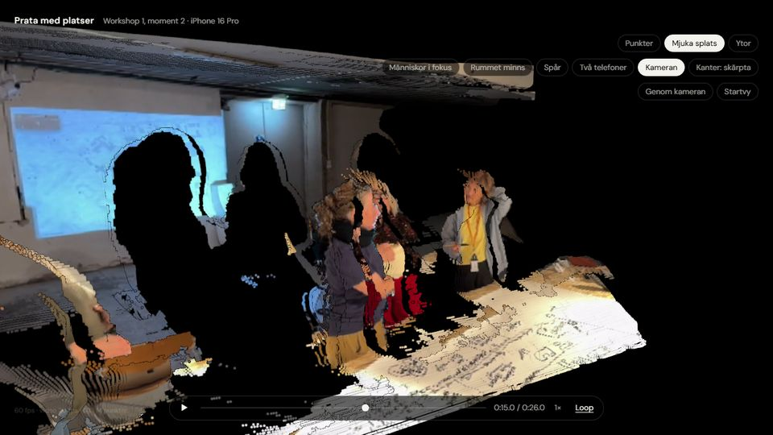

**Ytor.** Oriented surfels: one quad per sample, spanned by its neighbours'
positions, so it lies in the surface and stretches on slopes. Same accumulation.
This is the most continuous look. Oblique surfaces show some "shingling" from the
~6 mm depth quantisation of the hue encoding, even with light smoothing.

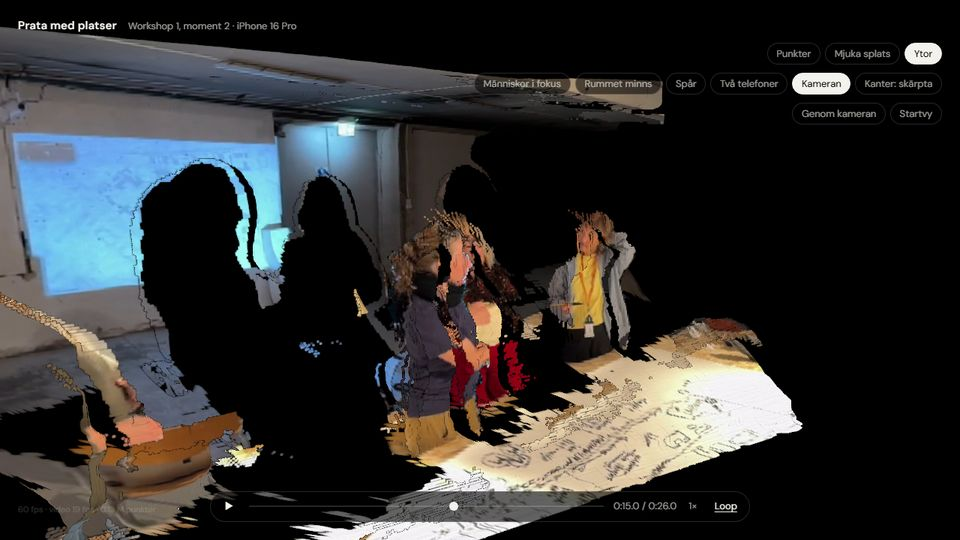

**Människor i fokus** (people in focus). The human stencil splits the frame:
people bright, dense and slightly larger, the room at a third of its samples and
a third of its brightness.

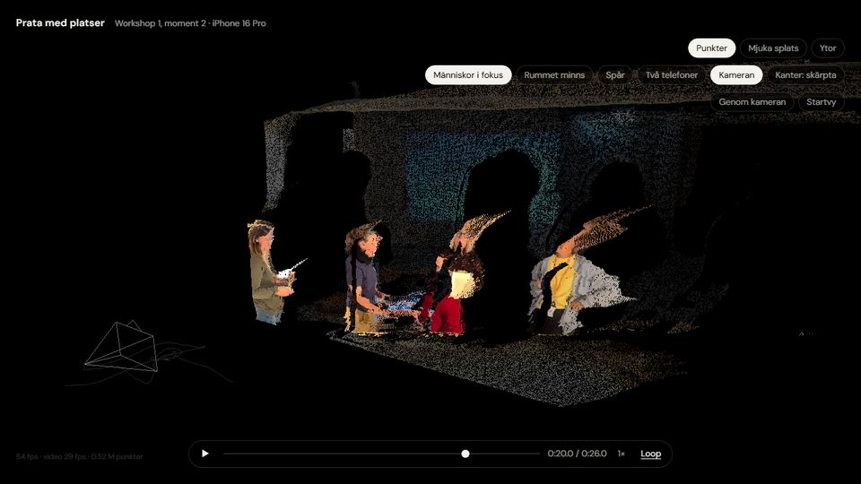

**Rummet minns** (the room remembers). Every 10th frame the room (never the
people, never edge samples) is decoded into one layer of a float array texture:
78 slots for the whole clip, 2.5M points, drawn in one call. As the handheld phone
looks around, the hall fills in while the people stay live. A slot is filled once,
the first time its frames play, and then kept across loops and seeks.

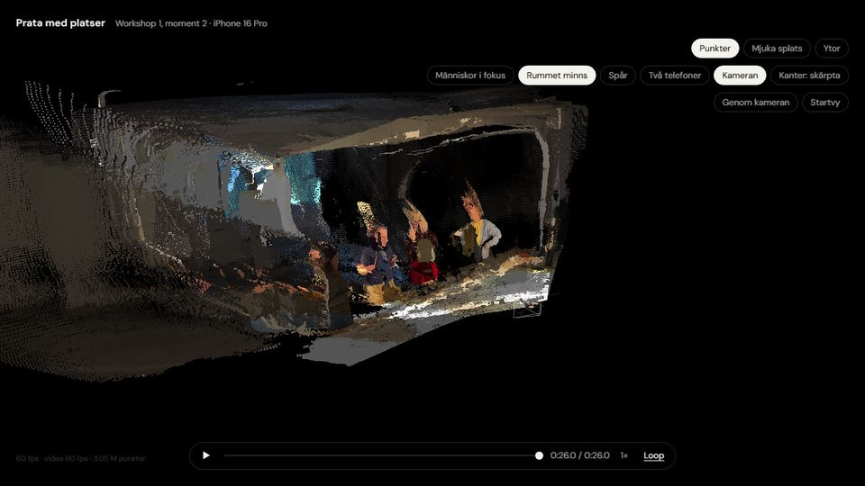

**Spår** (trails). The same ring buffer for the people of the last 14 × 2 frames,
fading and shrinking with age. Movement leaves smoke.

All of them together, with soft splats:

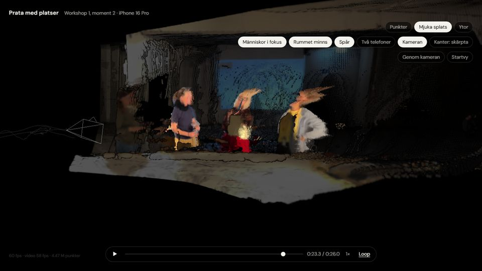

**Två telefoner** (two phones). The same 26 seconds as filmed by the 12 Pro on its
tripod, in the same space.

- *Time.* `metavido_sync.py` cross-correlates the two phones' audio (PHAT
  weighting). The 16pro-b video starts **341.217 s** after the 12pro video, and
  three independent 30 s windows agree within 3 ms. The sidecar headers'
  `startedAtServerMs` say 341.08 s, off by 137 ms, because the 12pro's
  `serverTimeOffsetKnown` is false. The page slaves the second video to the
  first one's clock, nudging the rate for drift and seeking for jumps.
- *Space.* `metavido_fuse.py` takes `T = M_16 · M_12⁻¹` from the sidecars'
  `markerAtStart` poses. Its rotation is 61.3° of yaw and only **0.41° of tilt**
  (both worlds are gravity-aligned, so tilt is marker error). Where the two
  phones see the same room, it agrees to a **median 26 mm**. ICP on the room made
  it worse (3.3° of tilt, because the overlap is only partial), so the marker
  transform is used as is.

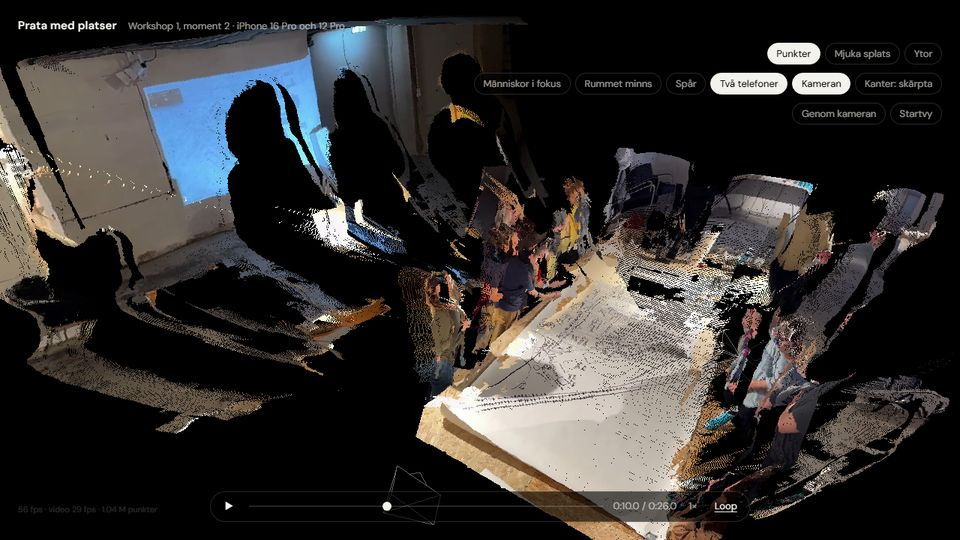
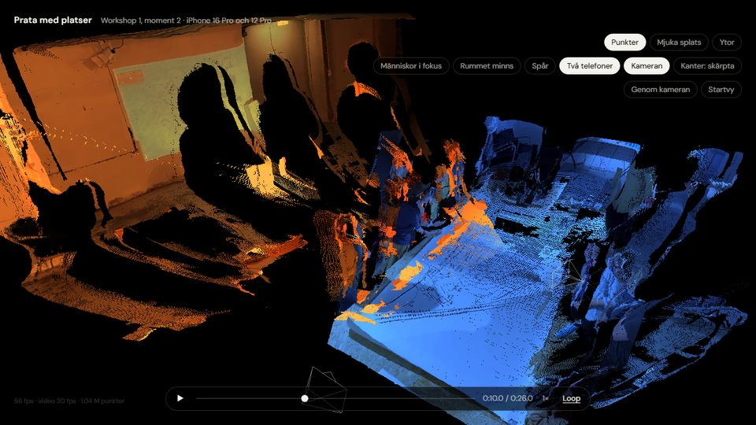

From above, and on a phone (half resolution, panel at the bottom):

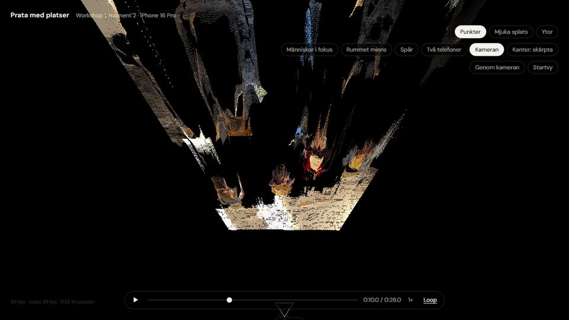
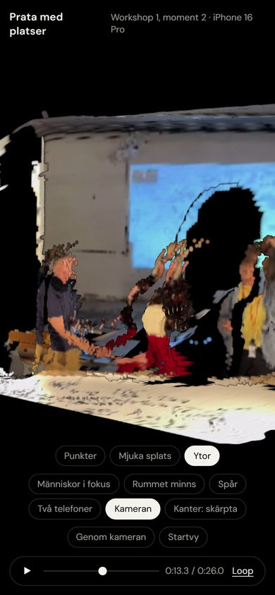

## Performance

Measured in headless Chrome on the RTX 3080 here, through the debug HUD's timer
query:

| | GPU per frame |
|---|---|
| Punkter, 1280×720 or 1920×1080 | 1.7–2.7 ms |
| Punkter at `res=2` / phone viewport | 1.2–1.5 ms |
| Mjuka splats, Ytor | 1.4–2.4 ms |
| Ytor + room memory + trails + two phones | 6.0 ms |

Everything holds the 60 fps vsync cap with the video at its full 30 fps. Cold
start (no shader cache) to first frame is 0.3–1.0 s. **Not measured on a real phone
or an integrated GPU.** By the numbers there is roughly 10× headroom, but that
needs a real device. Phones default to half resolution.

## What worked, what didn't, open problems

Worked:

- Live GPU decode, pose by frame number, sync verified. The build-time sidecar
  was the right call (see the bit flips above).
- Landscape recordings need no calibration fudge. Metric scale and level floor
  come straight out of the data.
- Stencil-guided edge snapping is the biggest single improvement in quality.
- Two phones in one space from the marker and audio alone, with no manual
  alignment.

Open problems:

- **Edges are heuristic.** Hair is fuzzy, people overlapping each other aren't
  separated (the stencil is one class), some short streaks remain, and there is
  the thin contour through the phone. The principled next step is a per-frame
  depth-cleaning pass. Classify reliable samples once into a texture, then fill
  the ramps per stencil class with a push-pull pyramid (or a joint bilateral
  filter guided by stencil and colour). Every layer would then read one clean
  depth texture. That's also faster, because the snapping search currently runs
  inside each layer's vertex shader. Watch out for interpolating across depth
  layers within the background class (table in front of a wall), which the
  current snap rule avoids.
- **Faint outline traces** remain on the walls in the combined views: coverage
  gaps where both the live layer and the memory leave out near-silhouette
  samples, and people barely move.
- **Single viewpoint.** Everything behind a person is a hole ("shadow"). The
  second phone fills some of it. Orbiting beyond ~50° from the recording
  direction shows the backs of things as hollow.
- **The 12 Pro recorded at ~18.7 fps.** 297 of its 780 frames are CFR
  duplicates, so its people move more choppily than the 16 Pro's.
- **Beyond ~5 m the depth is ARKit's estimate,** not LiDAR, and the far end of
  the hall is smooth and approximate. `maxDepth` is 9.5 m.
- Not done: a baked per-frame 4D-gaussian comparison. The live path turned out
  good and cheap enough that I spent the time on edges and fusion instead. A
  baked version would need per-frame optimisation offline, and its size would
  likely exceed the video's for 26 s.
- Testing note: on this PC the first headless Chrome launched after a while idle
  sometimes cannot create a WebGL context at all ("Web page caused context loss
  and was blocked"), before any page code runs. A second launch always works.
  It's environmental, but the page now shows a message instead of freezing if a
  context is ever lost.

## Effect on the rest of the site

- `vite.config.js` gets a third entry. three.js is now a shared chunk
  (`app/three.module.js`) between the splat viewer and this page, plus a small
  `modulepreload-polyfill.js`. So the built `web/app/main.js`, `map.js`,
  `brush.js`, `index.html` and `map/index.html` change, though not in behaviour.
  The home page (splat) and `/map/` load and render as before; the only console
  output is the same two three.js/Spark warnings as before.
- `scripts/stage5_web.sh` also runs its offline check over `web/video/index.html`.
  The check passes, and the video page makes no external requests.
- The dev server serves `web/assets/` with byte ranges, which also makes the
  splat load under `npx vite`.
- `web/` grows by 14 MB of clips (46 MB total, well under the Pages limits; the
  largest file is still the 31 MB splat).

## Recommendation for production

1. **Ship Punkter with snapped edges as the default, with "Ytor" one tap away.**
   Ytor is the more beautiful, but Punkter is the most honest and the cheapest,
   and it degrades gracefully at half resolution on phones. Leave out the debug
   options; keep "Genom kameran", which is what makes people believe it is real.
2. **Before that, do the depth-cleaning pass** described above. It's the
   remaining quality gap and a performance win.
3. **"Människor i fokus" and "Rummet minns" are the strongest artistic ideas.**
   The room as a dim memory with the people live in it suits a project about
   conversations with a place. Worth designing a scene around, perhaps as the
   only look on a specific page rather than as toggles.
4. **Two phones: worth continuing,** but plan it into the recording. Both phones
   on the same account (linked start, known clock offsets), the marker detected
   by both before every take, and the 12 Pro (or whatever second phone) at
   30 fps, perhaps with a lighter recording setting. Keep audio, because it's
   what aligns frames.
5. **On a real iPhone,** check Safari (requestVideoFrameCallback exists since
   15.4; the ring layers need float render targets) before promising it.
6. Keep each page to a handful of 20–30 s snippets (5–10 MB each at CRF 26).

## Git

Branch `metavido-viewer`, one commit per step on top of `main` (`be68832`):

1. Add Metavido feasibility study
2. Add volumetric video viewer at /video/
3. Sharpen depth edges around people, clean up the room memory
4. Add "Två telefoner": both phones of moment 2 in one space
5. Notes, screenshots, CLAUDE.md entry

Nothing is merged into or pushed to `main`. Merging would publish `/video/` on
pratamedplatser.se (unlinked, `noindex`).
